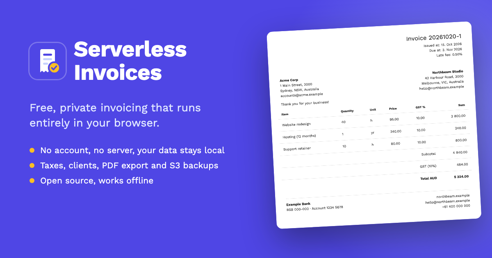

# Serverless Invoices



A free, open-source invoicing tool for freelancers and small businesses.

Data is stored in your browser — no server required. Run it locally or host it yourself.

Built with [Vue 3](https://vuejs.org/), [Vite](https://vite.dev/), [Pinia](https://pinia.vuejs.org/) and [Bootstrap 5](https://getbootstrap.com/).

> Originally created by [Moku](https://github.com/mokuappio/serverless-invoices). This fork is independently maintained.

## Features

- **Truly serverless** — data stored in your browser only; fonts and icons are bundled, so it makes no third-party requests and works fully offline
- **No hosting required** — works locally
- **Invoices**
  - Create & manage invoices
  - Track invoices by status and due date
  - Multiple custom taxes, late fees
  - Print to PDF
  - Customizable logo and template (CSS)
  - Duplicate invoices
  - Written-off status tracking
- **Bank accounts**
- **Clients**
  - Dedicated clients page to create & manage clients
  - Custom fields
  - Client search and ranking
- **Company details**
  - Edit default company details
  - Custom fields
  - Default taxes
- **Dashboard**
  - Totals at a glance: invoiced, paid, booked and outstanding
  - Financial year summaries with monthly bars
  - Search, status pills and overdue flags
  - Customer rankings
- **S3 backup** — one-click JSON backup to AWS S3, with the time of the last backup on the dashboard
- **Export & import** JSON data
- **Dark and light mode**
- **PWA support**
- **Browser storage** — data is kept in IndexedDB, and the app asks the browser to keep it persistent

## Requirements

- Node 20.19+ or 22.12+
- A current browser (Chrome/Edge 114+, Firefox 125+, Safari 17+): the UI uses native dialogs and popovers
- Docker (optional, for containerized setup)

## Project Setup

### 1. Install dependencies

```bash
npm install
```

### 2. Development

```bash
npm run serve
```

The dev server runs on http://localhost:8080.

### 3. Production build

```bash
npm run build
```

### 4. Lint

```bash
npm run lint
```

## Run with Docker

### Quick start (production build)

```bash
git clone https://github.com/rouralberto/serverless-invoices.git
cd serverless-invoices
docker build . -t serverless-invoices
docker run -p 80:8080 -d --rm serverless-invoices
```

You can add a shell alias for quick access:

```bash
echo "alias serverless-invoices='docker run -p 80:8080 -d --rm serverless-invoices'" >> ~/.zshrc
source ~/.zshrc
```

### Development with Docker Compose

The included `docker-compose.yml` sets up a dev environment with hot reload behind a reverse proxy.

1. Create a `docker-compose.override.yml` for your local environment variables (AWS credentials, etc.). See `.env.example` for available variables.

2. Start:
   ```bash
   docker compose up
   ```

## Environment Variables

| Variable | Description | Default |
|----------|-------------|---------|
| `VUE_APP_AWS_REGION` | AWS region for S3 backup | — |
| `VUE_APP_AWS_ACCESS_KEY_ID` | AWS access key | — |
| `VUE_APP_AWS_SECRET_ACCESS_KEY` | AWS secret key | — |
| `VUE_APP_BUCKET_NAME` | S3 bucket name | — |
| `DEV_SERVER_HMR_HOST` | Hot reload host, if a reverse proxy exposes it on a different host than the page | page host |
| `DEV_SERVER_HMR_PORT` | Hot reload port, if a reverse proxy exposes it on a different port than the page | page port |
| `CHOKIDAR_USEPOLLING` | Set to `true` to poll for file changes (e.g. Docker volumes) | — |

Variables prefixed with `VUE_APP_` or `VITE_` are embedded in the built app at build time.

## Configuration Files

| File | Created from | Purpose |
|------|-------------|---------|
| `docker-compose.override.yml` | — | Local Docker overrides |
| `public/.htaccess` | `public/.htaccess.example` | Apache rewrite rules so routes like `/invoices` work on reload |

## License

MIT — see [LICENSE](LICENSE).
